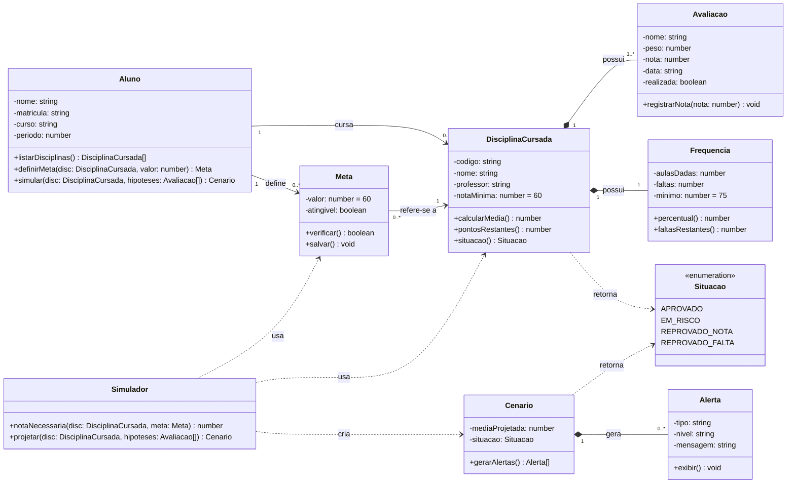

# Diagrama de Classes (Fluxo de Informação)

Fonte do diagrama (Mermaid). Usado na entrega 1 e no PDF final. Visibilidade: `+` público, `-` privado.

## Leitura do diagrama

- **Aluno** cursa várias **DisciplinaCursada** (a disciplina no contexto do aluno, com suas notas e faltas).
- **Composição** (losango cheio): `Avaliacao` e `Frequencia` só existem dentro da disciplina cursada. `Alerta` só existe dentro de um `Cenario`.
- **Meta** é definida pelo aluno para uma disciplina; é o que o usuário salva no passo 5.A da análise da tarefa.
- **Simulador** não guarda estado: recebe disciplina, meta e notas hipotéticas e devolve um **Cenario** com média projetada, situação e alertas. É o que alimenta os gráficos e o feedback da tela.
